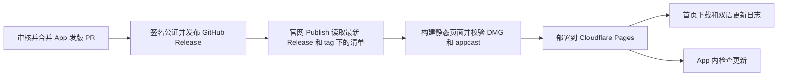

# CleanU 官网设计

## 版本更新与分发

官网通过同一次 Cloudflare Pages 部署发布首页、双语更新日志、最新稳定版 DMG 和公开的 `updates/appcast.json`。首页和更新日志的下载按钮、App 的更新清单都指向这次部署提供的同一版安装包。

### App 发布与数据来源

CleanU 仓库的 Release 工作流生成或复用中英双语发版 PR。维护者审核并合并后，工作流使用审核过的代码快照运行测试，构建、签名并公证 Universal DMG，再把项目版本、`changelogs.json` 和 `updates/appcast.json` 写入同一个发布提交与 tag。GitHub Release 正文取这次发布的 `notes.en`，并上传对应 DMG。上传成功后，App 工作流向官网发送 `cleanu-release` 事件，只传递发布 tag。App 的发版与重试步骤见 [CleanU 发版流程](https://github.com/openchic/cleanu/blob/main/docs/release.md)。

| 文件 | 用途 |
| --- | --- |
| CleanU 发布 tag 下的 `changelogs.json` | 官网更新日志的来源。保存各版本的中英文说明和发布日期，以及最新版本的 DMG 校验信息 |
| 官网的 `src/data/changelogs.json` | 本次构建使用的本地快照，由 Publish 从最新稳定 Release 对应的 tag 同步 |
| 官网发布的 `updates/appcast.json` | App 读取的公开更新清单，提供最新版本号及 DMG 的下载地址、大小和 SHA-256 |

### 官网同步与部署

1. `pnpm release:sync` 使用 `CLEANU_RELEASES_TOKEN` 查询 App 仓库最新的已发布稳定 Release，从其 tag 读取根目录 `changelogs.json`，核对版本及 DMG 附件，再生成构建快照。通知里的 tag 用于检查该版本已进入发布历史，即使旧通知迟到，也以当前最新稳定版构建。
2. 项目检查通过后，Astro 从快照生成中英文静态页面。更新日志保留双语历史，按页面语言展示 `notes.zh-CN` 或 `notes.en`。最新条目的发布日期取 GitHub Release 的发布时间。
3. `pnpm release:assets` 从同一 Release 下载 DMG，校验文件名、大小、SHA-256 和 25 MiB 上限，再输出 `downloads/{version}/{filename}` 与公开 appcast。Pages 只托管最新 DMG，旧包留在 App 仓库的历史 Release。appcast 的 `universal`、`arm64` 和 `x86_64` 条目引用同一个 Universal DMG。
4. `pnpm site:check` 检查静态页面、站内链接和购买回跳响应头。`pnpm release:check` 在部署前重新核对 Release 数据修订与线上 appcast，阻止版本降级和同版本安装包替换。校验失败时停止部署，线上继续提供上一份完整产物。

App 发版通知和手动运行 [Publish](../.github/workflows/publish.yml) 都会走同一套同步、构建和部署流程。通知触发只部署官网产物。手动 Publish 还会在部署成功后推送官网自己的版本提交与 tag，并创建官网 Release。

通知凭据保存在 App 仓库，Release 读取凭据保存在官网仓库。两者只供 CI 使用，配置步骤见 [官网同步凭据](https://github.com/openchic/cleanu/blob/main/docs/direct-distribution-setup.md#53-配置官网同步凭据)。

### 首页版本号与回访提示

首页使用生成下载链接的同一条记录显示版本号。信息行按价格、一次买断、永久更新、macOS 系统要求与 `v{version}` 排列。窄屏把系统要求和版本号放在同一行，购买信息可以按可用宽度换行。版本号可以点击或用键盘打开当前语言的更新日志，并定位到 `#release-v{version}` 对应条目。

浏览器首次访问时记录看到的版本号。回访发现更高版本时，在版本号右上角显示无文字的青绿色圆点，并记录新版本。同一版本下一次访问时不再提示。中英文首页共用同一份本地记录，旧缓存页面不会把它改回低版本。圆点表示官网已有新版本，比较的是该浏览器曾看到的版本。

官网只在浏览器本地保存已见版本，提示无需额外的网络请求。浏览器无法使用存储或禁用了 JavaScript 时，仍能使用静态版本链接和下载按钮。没有发布数据的本地预览省略版本号和圆点，下载按钮通向对应语言的更新日志。相邻目录有 App 仓库时，在官网根目录运行 `CLEANU_RELEASES_FILE=../clean-mac/changelogs.json pnpm dev` 即可用本地发布清单预览。

### App 内检查更新

用户从菜单栏主动检查更新时，App 读取官网的 `updates/appcast.json`，把其中的版本号与已安装版本比较。发现更高版本时，App 显示当前和可用版本，并在用户确认后通过浏览器打开本机架构对应的 DMG。清单没有对应下载地址时，转到该版本的更新日志。用户通过下载的 DMG 手动安装。版本相同或更低时提示已是最新版，请求失败或清单无效时提示检查失败。

## 购买配置与上线

官网使用 Dodo Live Mode 的正式付款链接。[purchase-config.json](../src/data/purchase-config.json) 保存公开的商品和付款链接默认值，构建时以非空的 `DODO_PRODUCT_ID` 和 `DODO_PAYMENT_LINK` 覆盖对应字段。

| 官网仓库变量 | 用途 |
| --- | --- |
| `PURCHASE_ENABLED` | 默认 `false`。完成上线验收后设为 `true` |
| `DODO_PRODUCT_ID` | 与正式 App 一致的 Dodo 商品 ID |
| `DODO_PAYMENT_LINK` | 同一商品在 `checkout.dodopayments.com` 上的 HTTPS 付款链接 |
| `SITE_URL` | 官网公开 HTTPS 地址，可含部署子路径。用于生成回跳地址和公开 appcast 下载地址 |

购买支持邮箱在 Dodo 商户后台维护。服务条款链接到帮助反馈页，帮助反馈页提供 Dodo 客户门户和 CleanU 支持邮箱。购买回跳页直接提供 Dodo 客户门户与 Dodo 官方联系入口。购买邮件未送达时仍可通过这些入口求助。商户 API key 只用于受信任的管理连接。

先保持购买关闭，发布并下载验收支持授权的 App，再核对正式商品、许可证发放、支持入口和购买到激活的链路，并在仓库文档记录结果。验收通过后，将 `PURCHASE_ENABLED` 设为 `true` 并运行完整 Publish 流程。

暂停新购买时，将 `PURCHASE_ENABLED` 设为 `false`，再运行同一个 Publish 流程。官网继续提供下载、激活指引、条款与支持入口，已购买用户仍由 App 直接向 Dodo 校验授权。
